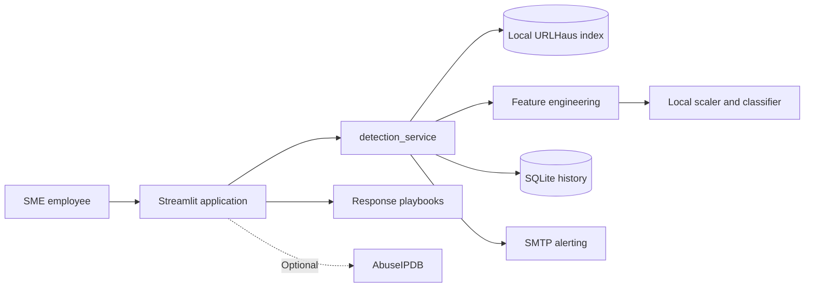

# CyberVeille PME - Early cyber-threat detection

Public code sample for a defensive security MVP that helps small and medium
businesses assess suspicious URLs, keep a local incident history and notify a
security contact when a high-risk event is detected.

The repository contains the application code, tests and generic response
playbooks. Internal stage documents, reports, screenshots, generated models
and downloaded datasets are intentionally excluded from the public repository.

## What the MVP demonstrates

- Local URL validation and lexical feature extraction.
- Threat-intelligence lookup against a locally collected URLHaus index.
- A scikit-learn phishing classifier with an explicit unavailable-artifact
  state when local model files are not installed.
- SQLite incident history with parameterized queries.
- Optional SMTP notifications with deduplication and environment-based
  configuration.
- Optional AbuseIPDB lookup when an API key is provided locally.
- Streamlit pages for single-URL analysis, CSV analysis, history, alerts and
  practical response playbooks.

## Architecture



## Repository layout

- `app.py`: Streamlit interface.
- `detection_service.py`: central detection workflow and risk decision.
- `feature_engineering.py`: URL feature extraction.
- `train_model.py`: local model training and evaluation entry point.
- `predict.py`: command-line URL prediction.
- `Download_urls.py`: URLHaus collection script.
- `database.py`: local SQLite persistence.
- `alert_service.py`: configurable SMTP notifications and deduplication.
- `ip_reputation_service.py`: optional AbuseIPDB integration.
- `fiches_reflexes/`: generic response playbooks.
- `tests/`: automated MVP tests.
- `data/README.md`: public data sources and local preparation instructions.
- `models/README.md`: local model-artifact instructions.

## Installation

### Windows PowerShell

```powershell
python -m venv venv
.\venv\Scripts\Activate.ps1
pip install -r requirements.txt
Copy-Item .env.example .env
```

### Linux or macOS

```bash
python3 -m venv venv
source venv/bin/activate
pip install -r requirements.txt
cp .env.example .env
```

The `.env` file is local only. Never commit SMTP passwords or API keys.

## Local data and model preparation

Large source datasets, URLHaus exports and generated model files are not
committed. Follow [data/README.md](data/README.md) and
[models/README.md](models/README.md) to reproduce them locally.

Without local artifacts, the application remains safe to inspect and run, but
reports that the corresponding data or model component is unavailable instead
of inventing a verdict.

## Run the application

```powershell
streamlit run app.py
```

The application never opens the URL under analysis and does not automatically
read Gmail or Outlook mailboxes.

## Detection workflow

1. Validate the HTTP(S) input locally.
2. Check the local URLHaus index when available.
3. Extract the URL features used by the classifier.
4. Load the locally prepared scaler and model when available.
5. Produce a probability estimate and a risk level.
6. Store the result in SQLite and send an alert when configured.

An URLHaus match is treated as a critical signal. Absence from URLHaus never
proves that a URL is legitimate. The model convention used by the training
script is `0 = phishing` and `1 = legitimate`.

## Tests

```powershell
python -m unittest discover -s tests -v
```

The tests cover invalid input, feature extraction, URLHaus availability,
SQLite persistence, disabled alerts, SMTP failures, missing model artifacts
and bulk CSV analysis.

## Publication boundary

This public repository is limited to reproducible code and generic technical
documentation. Do not add internal correspondence, supervision details,
convention documents, reports, private screenshots, operational data or
credentials.
